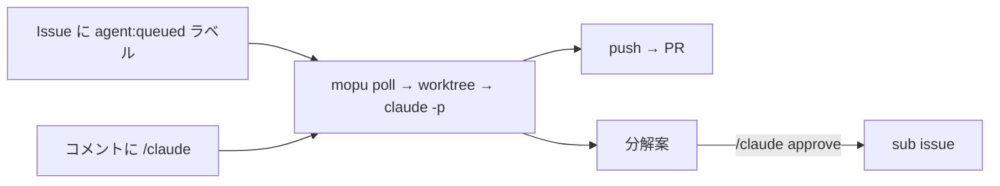

# mopu-agent

GitHub の Issue / PR コメントをトリガーに、ローカルの Claude Code へタスクを投げるポーリング型エージェント。
Anthropic API key を使わず、ログイン済みの `claude` CLI（サブスクリプション認証）でそのまま動く。



## 依存

- `gh` 2.73.0 以上 — これ未満は `gh pr edit` が Projects (classic) 廃止の GraphQL エラーで落ちる
- `jq`
- `git`
- `claude`
- `bubblewrap` と `socat` — sandbox 用。Ubuntu 24.04 以降は AppArmor のプロファイルも要る（[Sandboxing](https://code.claude.com/docs/en/sandboxing)を参照）
- `timeout`
- `tar` — Web コンソールのログのダウンロード用
- `nim` — `bin/mopu` のビルドに使う。バージョンは `.tool-versions` で固定

## セットアップ

```bash
nim build                          # bin/mopu をビルド（ソースを更新したら再度）
cp config.env.example config.env   # コンソールの待受先など（既定のままでよければ不要）
./bin/mopu console                 # → http://127.0.0.1:8787 の「設定」で対象リポジトリ（複数可）とユーザーを登録
./bin/mopu setup                   # ラベル作成 + 依存確認
./bin/mopu poll --dry-run          # 検出されるタスクを確認
```

設定は `state/settings.json` に保存される。

### GitHub App を登録する

GitHub App の登録は必須で、登録するまでポーリングは動かない。Issue コメントも PR も `<app-slug>[bot]` 名義になる。

App の登録・秘密鍵の生成・インストールは公式ドキュメントに従う。
- [Registering a GitHub App](https://docs.github.com/en/apps/creating-github-apps/registering-a-github-app/registering-a-github-app)
- [Managing private keys for GitHub Apps](https://docs.github.com/en/apps/creating-github-apps/authenticating-with-a-github-app/managing-private-keys-for-github-apps)
- [Installing your own GitHub App](https://docs.github.com/en/apps/using-github-apps/installing-your-own-github-app)

Webhook は Active のチェックを外す。Repository permissions は次のものだけ与える。

| 権限 | レベル | 用途 |
|---|---|---|
| Contents | Read and write | ブランチの push |
| Issues | Read and write | コメント投稿、ラベル操作 |
| Pull requests | Read and write | PR の作成、レビュアーの指定 |
| Actions | Read-only | CI の結果とログを読む |
| Metadata | Read-only | 必須（自動で付く） |

App ID と秘密鍵（`.pem`）は、コンソールの「設定」タブで登録する。鍵を差し替えるときは、削除してから登録し直す。

### Nextcloud Talk に通知する（任意）

タスクの進み具合を、Nextcloud Talk の会話に bot が投稿する。
bot の登録と会話での有効化は Nextcloud 側で行う（[Talk の bot のドキュメント](https://nextcloud-talk.readthedocs.io/en/latest/bots/)）。
コンソールの「設定」タブで、bot の secret と会話の token（会話の URL の `/call/` に続く英数字）を登録する。

## 使い方

### ラベルでトリガーする

Issue に `agent:queued` を付けて `./bin/mopu poll` を実行する。

```
agent:queued ──▶ agent:running ──▶ agent:done
                       ├────────▶ agent:failed
                       ├────────▶ agent:awaiting-input ──(/claude で回答)──▶ agent:running
                       └────────▶ agent:awaiting-approval ──(/claude approve)──▶ agent:done
```

タスクが大きいとエージェントは実装せず分解案をコメントし、`agent:awaiting-approval` で止まる。
`/claude approve` とコメントすると sub issue が作られる。`/claude` に続けて修正点を書くと、案を作り直す。
ラベルを外すか Issue を閉じると却下になる。

作られた sub issue には `agent:queued` が付き、次の poll から実装される。sub issue がすべて閉じると、親 Issue も閉じる。

依頼が曖昧なときは、エージェントは実装せず質問をコメントし、`agent:awaiting-input` で止まる。
`/claude` に続けて回答を書くと、同じ会話の続きとして作業が再開する。

`agent:failed` で止まった Issue は、`./bin/mopu poll --retry <番号>` で止まった段階からやり直せる。

### コメントでトリガーする

Issue や PR のコメントで、**行頭**に `/claude` と書く。

```
/claude この関数のテストを追加して
```

コードブロック（``` で囲んだ部分）の中の `/claude` は無視される。

同じ PR に複数の `/claude` コメントが溜まっていた場合は、1 回でまとめて対応する。
PR で指示した場合も、ブランチ・ラベル・sub issue は元 Issue 側で扱われる。

mopu-agent 以外が出した PR（Dependabot など）で指示すると、新しい PR を作らず、その PR のブランチにコミットを足す。

### PR と報告

PR は実装を初めて push したときに Draft で作られ、リポジトリの CI はこの PR で動く。CI とレビュアー（critic）の確認を通ったときだけ Open になり、レビューが依頼される。
通らなかった PR は Draft のまま `agent:failed` で止まり、理由が PR のコメントに書かれる。

コメントへの返信は、**指示が来たコメントと同じ場所**に返る。コメントごとに分かれ、それぞれのスレッドへ返る。

| 指示を書いた場所 | 返信先 |
|---|---|
| Issue のコメント | その Issue |
| PR の会話コメント | その PR |
| PR のレビューコメント | そのレビュースレッドへの返信 |

返信以外の報告（分解案、失敗、検証を通らなかった理由）は、PR が無ければ Issue に、あれば PR に書かれる。Issue には、PR を作ったときに 1 回だけ知らせが付く。

### 対象リポジトリの指示

対象リポジトリの次のファイルを、ベースブランチから読んでエージェントに渡す。

- ルートの `CLAUDE.md` と `.claude/CLAUDE.md`。どちらも無ければ `AGENTS.md`
- `CLAUDE.md` の `@path` が指すファイル。リポジトリ内の相対パスだけ
- `.claude/rules/` の `.md` と、サブディレクトリの `CLAUDE.md`

PR の中で書き換えた指示は、マージしてベースブランチに入るまで効かない。
`.claude/settings.json` の hooks と permissions、skills、MCP の設定は読まない。

### 差し戻しを振り返る

コンソールの設定で「差し戻しを振り返る」をオンにすると、差し戻しのあった PR が数件マージされるたびに、対象リポジトリの指示（`.claude/rules/` など）の変更案が Issue として出る。
案を採るなら、人間が文書に置く。Issue を not planned で閉じると、同じ趣旨の案は以後出ない。

### オプション

`./bin/mopu --help` と `./bin/mopu poll --help` を参照。

## 制限

- エージェントは sandbox の中で動く。書き込みは作業ディレクトリだけ、Bash からの通信はパッケージレジストリと GitHub API だけで、`docker` は使えない。
  docker が要る検証は、設定に登録したものだけをホストのコンテナで回せる。それ以外は CI に任せる。
- `mopu poll` 単体では自動起動しない。定期実行するなら Web コンソール（`./bin/mopu console`）を使う。間隔は控えめにすること。
- コンソールは認証を持たない。触れる人は、依存の準備コマンドとコンテナの検証を通じてホスト上で任意のコマンドを実行できる。
  前段のプロキシで `Host` を書き換えると、画面から操作できなくなる。
- 計測タブの差し戻しの分類は LLM で行う。差し戻し 1 件につき 1 回分の利用枠を使う。
- コンソールのログの書き出しには、設定とコスト実績が入る。GitHub App の鍵、Nextcloud の secret、作業ツリーは入らない。
  トークンと秘密鍵の形をした文字列は `***` に置き換わる。

## ライセンス

MIT — [LICENSE](LICENSE) を参照。
